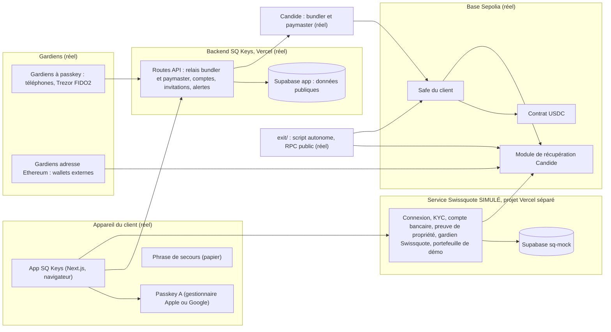

# CDC.md : SQ Keys, cahier des charges final

Hackathon BSA x EPFL, Lausanne, du samedi 10 octobre 2026 à 11h au dimanche 11 octobre 2026 à 11h.
Équipe : Aaron (technique et juridique), Téo (design et front), Théotime (business case, pitch, script de sortie `exit/`, service simulé `sq-mock/`).
**Version finale v2.6**, du 10 octobre 2026 à 15h15. Elle remplace toutes les versions précédentes et sert de seule référence pendant la construction. En cas de conflit, les consignes officielles de Swissquote (section 1) priment.

## Changements de la v2.5 à la v2.6 (à transmettre à Téo et Théotime)

1. **Bitcoin devient un livrable, plus une option.** L'équipe a appris que la grande majorité des clients crypto de Swissquote ne détient que du Bitcoin (chiffre exact à faire confirmer par le jury, ne pas l'énoncer comme un fait de Swissquote tant qu'il n'est pas confirmé). La section 7.10 est complétée (7.10.0) : une slide dédiée et la démo sur signet avec Liana sont **prévues par défaut**, la démo n'étant abandonnée que si le jury dit qu'un chemin crédible suffit.
2. **Planning** : démarrer tôt le téléchargement et la synchronisation de Liana sur le PC de Téo (c'est le principal risque), créneau de la démo de 3h45 à 5h15, la console passe de 5h15 à 7h30.
3. **Palier 1** : le correctif du palier 1 (endpoint Candide unique, RLS, déploiement CLI) n'a pas été ajouté au prompt déjà lancé. Il sera appliqué au début du palier 2a.

---

## Changements de la v2.4 à la v2.5

1. **Bitcoin** : nouvelle section 7.10. La plupart des clients crypto de Swissquote détiennent du Bitcoin. On ne pivote pas, mais on montre le même modèle de garde sur Bitcoin en Miniscript, avec le wallet open source Liana comme référence. Phrase de pitch en section 11.3. Démo sur signet seulement si le jury l'attend (section 7.10.5).
2. **Déploiement** : pas d'intégration GitHub. Le déploiement se fait depuis le PC d'Aaron avec la CLI Vercel (`npx vercel --prod`). L'URL de production fixe est **https://sq-keys.vercel.app** : toutes les passkeys se créent là, jamais sur une URL de déploiement individuelle. Téo pousse sur `teo/ui`, Aaron fusionne et déploie.
3. **Candide** : un seul endpoint pour le bundler et le paymaster sur Base Sepolia.
4. **Supabase** : le projet de l'app (« sq-keys-app », Zurich, RLS activé) est sur le compte d'Aaron. Le projet de `sq-mock` est sur le **compte de Théotime** (limite de 2 projets gratuits par compte). `sq-mock` est déployé par Théotime sur son Vercel, à une URL fixe.

---

## Changements de la v2.3 à la v2.4

1. **La présentation est en anglais.** Sont en anglais : l'app, tous les textes d'écran (`design/textes.md`), les documents juridiques affichés dans l'app, le README, les commentaires du code, les messages de commit, le pitch et les slides. Le CDC reste en français (document interne).
2. **Textes d'écran imposés en anglais** : nouvelle section 10.7. Ils sont normatifs. Les textes cités en français ailleurs dans le CDC donnent le sens ; c'est la version anglaise de 10.7 qui s'affiche.
3. **Message de preuve de propriété** en anglais (section 4).
4. Sections 0, 10, 11 et 13 mises à jour en conséquence.

---

## Changements de la v2.2 à la v2.3

1. **Compte de démo `exit/`** : phrase + **3** gardiens par adresse, k = 2 (seuil 3 sur 4). Le chemin « phrase perdue » existe, conformément à nos propres règles (n ≥ k + 1).
2. **`sq-mock/` confié à Théotime** (son Claude Code), juste après `exit/`. Aaron ne fait plus que l'intégration dans l'app. Prompt dédié fourni à part.
3. **La preuve de propriété ne se coupe plus** : elle répond au sujet obligatoire 3 (lien avec l'identité).
4. **Alertes de récupération : jamais par e-mail.** L'e-mail peut être contrôlé par l'attaquant (P7). Elles passent par les appareils enregistrés du client, les gardiens et un appel de Swissquote (simulé). Textes d'écrans corrigés (section 10.2).
5. **« Refuser et alerter » est une protection applicative** : elle sert à alerter tôt. La protection réelle est le seuil k + 1 sans la phrase, puis le délai et l'annulation par A. Un attaquant peut contacter les gardiens par d'autres moyens (P7, P9, section 6, pitch).
6. **Recherche d'un compte par identifiant client** (`startRecovery`) : elle passe par `sq-mock` (`/resolve-account`), jamais par le Supabase de l'app. Le Supabase de l'app ne contient aucun identifiant ni nom de client (sections 4, 7.4, 7.6, 8.5).
7. **Démo** : saisie des 12 mots en direct (30 à 45 s) intégrée au minutage ; un extrait vidéo de secours par segment ; répétition chronométrée avant minuit (sections 11 et 12).
8. **Planning recalé** sur un palier 0 lancé à 12h30 (section 12).

---

## Changements de la v2.1 à la v2.2

1. **Consignes officielles intégrées** (section 1). Elles priment sur tout le reste.
2. **Sortie sans Swissquote, montrée** : nouveau type de gardien « adresse Ethereum », indépendant du domaine, et script autonome `exit/` qui récupère un compte avec la phrase et ces gardiens, sans aucun service Swissquote. **Construit par Théotime avec son Claude Code**, et montré en vidéo (sections 3.6 et 7.8).
3. **Scénario bonus officiel en direct** : un attaquant a volé le téléphone (verrouillé) et l'e-mail du client. Il lance « J'ai perdu mon accès », le gardien voit un appareil inconnu, appelle le client et clique **« Refuser et alerter »** (P7).
4. **Signatures hors chaîne** : la phrase de secours et les gardiens par adresse Ethereum approuvent par signature EIP-712, sans Safe gardien. Les gardiens à passkey gardent leur Safe gardien (section 3.3).
5. **Règle** : si l'assistance Swissquote est gardien, k ≥ 2. Swissquote et un seul partenaire ne peuvent donc jamais atteindre le seuil (section 3.3).
6. **Modèle de menaces complet** : qui peut voler, qui peut bloquer l'accès, Swissquote seul ou avec un partenaire (Candide, Apple ou Google, Vercel, frontend) (section 6).
7. **Service Swissquote simulé séparé** (`sq-mock/`) : second projet Vercel avec son propre Supabase. Il détient la clé du gardien Swissquote, le KYC, le compte bancaire et le portefeuille de démonstration. L'app n'y a jamais accès (section 7.4).
8. **Transactions sans gas** : les clés du bundler et du paymaster restent côté serveur, derrière un relais avec des règles anti-abus. On explique qui paie (section 7.5).
9. **Stockage** : Supabase pour l'app, un projet Supabase distinct pour `sq-mock/`.
10. **Nouvelles sections** : création du wallet et lien avec l'identité Swissquote (section 4), schéma d'architecture en Mermaid (section 7.1), question « EVM uniquement ? » (section 7.9), outils d'IA utilisés (section 14).
11. **Juridique** : paiement à un tiers depuis le wallet (Swissquote n'est pas l'institution émettrice), et zone grise « Swissquote plus un partenaire » (section 8).
12. **Démo** : une récupération légitime lancée au début du pitch et finalisée à la fin, plus le refus de l'attaquant en direct (section 11).
13. **Écrans** : liste exacte des écrans à corriger, ajouter ou supprimer (section 10). Plusieurs textes des maquettes affirment des choses fausses ; ils sont à retirer.
14. **Planning** recalé sur un palier 0 lancé à 12h15 (section 12).

---

## 0. Pour Claude Code : à lire en premier

- Tu construis un prototype de wallet en auto-garde pour Swissquote, sur **EVM (Base Sepolia, testnet)**, avec un **Safe** piloté par **AbstractionKit (Candide)**.
- Aaron ne code pas à la main. Tu exécutes tout, tu expliques chaque étape en une phrase, et tu dis comment vérifier le résultat (écran, terminal, explorateur de blocs).
- Tu respectes l'ordre des paliers de la section 12. Tu ne commences jamais un palier si le précédent n'est pas commité et vérifié.
- Règles absolues :
  - testnet uniquement ;
  - aucune clé privée, phrase de secours ou clé d'API dans le code, un commit ou un message ;
  - **les URL et clés du bundler et du paymaster Candide, et les clés service_role de Supabase, ne sont jamais dans une variable `NEXT_PUBLIC_`**. Le navigateur passe par nos routes serveur ;
  - l'app client n'a **jamais** accès à la clé du gardien Swissquote ni à celle du portefeuille de démonstration : elles vivent dans `sq-mock/` ;
  - aucune cryptographie maison : AbstractionKit, viem, ox, @scure/bip39 (via viem), @supabase/supabase-js ;
  - si une approche bloque plus de 30 minutes, tu t'arrêtes et tu proposes le plan B prévu.
- **Langue : anglais** pour l'app, tous les textes d'écran, les documents juridiques affichés, le README, les commentaires du code et les messages de commit. Les textes exacts sont dans `design/textes.md` (Téo, en anglais) et, pour les textes imposés, dans la section 10.7 : tu les copies sans les réécrire. Ce CDC reste en français.
- Le front est construit par Téo (`components/ui/`, `app/console/`, branche `teo/ui`). Le contrat entre son front et ta logique est `lib/sqkeys.ts` (section 7.7).
- `exit/` et `sq-mock/` sont construits par Théotime avec son propre Claude Code (branche `theotime/sq`). Tu n'y touches pas sans le demander ; tu consommes l'API de `sq-mock` décrite en 7.4.

---

## 1. Consignes officielles de Swissquote (prioritaires)

### 1.1 Le défi
Construire le wallet en auto-garde que Swissquote pourrait lancer demain : le client détient ses clés sans perdre la sécurité, la simplicité et la conformité d'une banque suisse. Aujourd'hui, il retire ses cryptos vers un wallet externe et quitte l'écosystème Swissquote. Notre wallet doit lui offrir mieux : ses clés, son contrôle, à un pas de son compte Swissquote. L'ingénierie compte d'abord, mais les meilleurs projets montrent aussi que le wallet pourrait exister légalement en Suisse et qu'il a du sens pour Swissquote.

### 1.2 Contraintes techniques
- Pas de cryptographie réinventée : bibliothèques et SDK open source établis (Safe, outils ERC-4337, WebAuthn). La cryptographie maison est pénalisée.
- Simuler est permis si c'est honnête et clairement signalé dans la démo et le README. **Un détenteur de part simulé doit tourner dans un processus séparé, avec son propre stockage, et l'app client ne doit jamais détenir sa part.** Pour nous : le gardien Swissquote vit dans `sq-mock/`.

### 1.3 Les six sujets obligatoires, et où on les traite
La démo doit montrer **une histoire de bout en bout : créer un wallet, se connecter et signer une transaction, perdre le wallet ou ses clés, récupérer l'accès.** La transaction doit être signée et envoyée sur une blockchain (testnet accepté).

| Sujet | Ce qui est demandé | Où |
|---|---|---|
| 1. Modèle de garde | Choix défendu, avantages, inconvénients, modèle de menaces court : qui peut voler les fonds, qui peut bloquer le client, Swissquote seul ou avec un partenaire peut-il déplacer les fonds ? | Sections 3 et 6 |
| 2. Architecture | Schéma des composants (app, backend, stockage des clés, contrats, chaîne), qui parle à qui, réel ou simulé | Section 7 |
| 3. Création du wallet | Où les clés naissent, où elles vivent, comment le wallet est relié à l'identité existante du client | Section 4 |
| 4. Authentification | Comment le client prouve qui il est avant de signer ; différence entre petite et grosse transaction | Section 3.7 |
| 5. Récupération | Perte, vol, destruction ; qui intervient, combien de temps, ce qui empêche un attaquant d'utiliser le même chemin ; **comment le client récupère ses fonds si les services de Swissquote disparaissent** ; bonus si la démo montre le refus d'un attaquant qui a volé **le téléphone et l'e-mail** | Sections 3.3, 3.6, 5 (P6, P7), 11 |
| 6. Business case | Ce que Swissquote y gagne, concret, un paragraphe suffit | Section 9 |

### 1.4 Bonus (jusqu'à 10 points chacun, seulement si l'histoire complète fonctionne)
- **Transactions sans gas** : le client n'achète pas d'ETH. Il faut expliquer **qui paie et comment on empêche les abus** (section 7.5).
- **Interaction conforme avec les dApps** : liste approuvée, filtrage des sanctions, simulation expliquée en langage clair avant signature, contrôles au-dessus d'un seuil (P3).

### 1.5 Notions juridiques imposées
- La garde dépend de qui peut déplacer les fonds. Si Swissquote le peut seul, c'est de la garde, avec les règles d'une banque. S'il ne peut pas agir seul, le wallet est plus proche d'un logiciel. Le contrôle partagé avec un tiers (Swissquote plus un partenaire) est une zone grise : il faut argumenter (section 8.1).
- Règle de voyage : une banque suisse ne peut envoyer ou recevoir des cryptos depuis un wallet externe qu'après avoir vérifié qui le détient. Comment notre wallet le fait-il automatiquement ? Et quand le client paie un tiers depuis son wallet, Swissquote est-il l'institution émettrice ? (section 8.2)

### 1.6 Ce que la description du projet doit couvrir
Modèle de garde et de menaces ; schéma d'architecture avec les parties simulées ; garde et règle de voyage ; ce que Swissquote gagne ; bonus traités ; **outils d'IA utilisés et usage de chacun** (section 14).

### 1.7 Notation
| Critère | Points | Ce que regarde le jury |
|---|---|---|
| Implémentation technique | 35 | Créer, signer, récupérer fonctionne de bout en bout ; code propre |
| Sécurité et modèle de garde | 20 | Modèle argumenté, menaces crédibles, récupération impossible à détourner |
| Faisabilité juridique | 15 | Raisonnement réaliste sur la garde et la vérification de propriété |
| Business case | 15 | Valeur claire pour les clients et pour Swissquote |
| Expérience et pitch | 15 | Un client non technique peut s'en servir ; la démo raconte une histoire claire |
| Bonus | +20 | 10 pour le sans-gas, 10 pour les dApps |

### 1.8 Précisions orales du lancement (10 octobre)
Swissquote veut permettre à ses clients des opérations qu'il n'autorise pas sur sa plateforme (par exemple la DeFi), **sous leur seule responsabilité**, sans perdre ces clients. L'app **avertit mais n'interdit pas**. Le seul refus porte sur les sanctions, et c'est Swissquote qui refuse ses propres services.

### 1.9 Rendu
Lien GitHub sur DoraHacks au plus tard dimanche à 11h. **Objectif : soumettre à 10h30.** Dépôt public.

---

## 2. Le produit en une phrase

**SQ Keys** : l'option auto-garde de Swissquote. Le client signe seul avec la passkey de son téléphone. Pour récupérer son compte, il faut sa phrase de secours **et** les gardiens qu'il a choisis, puis un délai pendant lequel il peut tout annuler. Personne d'autre que lui ne peut déplacer ses fonds, aucun élément seul ne suffit à prendre son compte, et il peut récupérer ses fonds même si Swissquote disparaît.

Message pour le jury : « Vos clés, votre contrôle. Swissquote ne détient aucune clé. Une phrase volée ne suffit pas, un gardien seul non plus, Swissquote non plus. Et si Swissquote fermait demain, vous récupéreriez vos fonds sans lui. »

---

## 3. Modèle de garde

### 3.1 Choix et justification
**Modèle retenu** : smart account (Safe, ERC-4337) contrôlé par une passkey, avec récupération sociale (phrase de secours et gardiens choisis par le client, seuil, délai, annulation). C'est une combinaison de trois modèles du tableau des consignes : smart account, phrase de secours et gardiens.

| Avantages | Inconvénients |
|---|---|
| Swissquote ne détient aucune clé : c'est du logiciel, pas de la garde | EVM uniquement (section 7.9) |
| Signature simple et rapide (Face ID, empreinte ou code) | La passkey du téléphone est synchronisée par Apple ou Google : un compte Apple ou Google piraté équivaut à un téléphone déverrouillé |
| Aucun élément seul ne permet de prendre le compte (phrase, gardien, Swissquote) | Un client qui perd tout (téléphone, phrase, gardiens) perd ses fonds |
| Récupération sans Swissquote possible | Les gardiens doivent rester joignables : le client les entretient |
| Règles lisibles on-chain, contrats audités et publics | Gas à payer (sponsorisé par Swissquote) |

Modèles écartés :
- **Garde par Swissquote** : c'est le « Wallet » existant, que le client quitte aujourd'hui ;
- **phrase seule** : un client moyen la perd ou se la fait voler, sans recours ;
- **MPC** : il faudrait un serveur de parts, ce qui crée une dépendance à Swissquote, et la bibliothèque est plus risquée à intégrer en 24h. C'est la piste de production pour Bitcoin (section 7.9).

### 3.2 Les clés et leurs rôles
| Élément | Nom dans l'app | Où il naît et vit | Rôle on-chain | Pouvoir |
|---|---|---|---|---|
| **A** | Clé du téléphone | Passkey créée par le téléphone (WebAuthn), synchronisée par Apple ou Google. Face ID, empreinte ou code. | **Seul propriétaire du Safe**, seuil 1 | Signer seule toutes les opérations ; gérer gardiens et phrase ; annuler une récupération |
| **S** | Phrase de secours | 12 mots BIP-39 générés dans le navigateur, notés sur papier, jamais envoyés | Gardien (adresse dérivée des 12 mots) | Une voix, par signature hors chaîne. **Seule, elle ne suffit jamais.** |
| **G passkey** | Gardien : mon autre appareil, un proche, clé physique | Passkey sur l'appareil du gardien ou sur la Trezor (FIDO2), qui contrôle un petit Safe gardien | Gardien (adresse du Safe gardien) | Une voix, par transaction sponsorisée depuis son Safe gardien |
| **G adresse** | Gardien : adresse Ethereum | Wallet existant du gardien (wallet matériel, MetaMask, Rabby…), **indépendant du domaine SQ Keys** | Gardien | Une voix, par signature hors chaîne. Utilisable sans Swissquote |
| **GSQ** (optionnel) | Assistance Swissquote | Clé de Swissquote : HSM en production, clé de test dans `sq-mock/` (jamais dans l'app) | Gardien | Une voix, après vérification d'identité. Jamais suffisante seule |

### 3.3 La récupération
- Gardiens inscrits dans le module Social Recovery de Candide : {S, gardiens choisis, et GSQ s'il est choisi}. Le module ne connaît pas de poids : chacun compte pour une voix.
- Le client choisit **k**, le nombre de gardiens exigés en plus de la phrase. **Seuil on-chain = k + 1.**
- Chemins valides :
  - **phrase + k gardiens** (récupération normale) ;
  - **k + 1 gardiens sans la phrase** (phrase perdue).
- Règles imposées par l'app :
  - **k ≥ 1** : la phrase seule ne suffit jamais ;
  - **n ≥ k + 1** (n = gardiens hors phrase), pour que le chemin « phrase perdue » existe ;
  - **si l'assistance Swissquote est gardien : k ≥ 2**, donc Swissquote et un seul partenaire (gardien ou voleur de la phrase) n'atteignent jamais le seuil.
- Recommandations affichées :
  - 4 gardiens avec k = 2 (seuil 3 sur 5) ; avec 3 gardiens et k = 2, une phrase perdue plus un gardien perdu bloquent la récupération ;
  - au moins k gardiens de type « adresse Ethereum », pour que la sortie sans Swissquote fonctionne (section 3.6) ;
  - avertissement si k = 1.
- **Approbations** :
  - phrase et gardiens par adresse : signature EIP-712 hors chaîne (`getRecoveryRequestEip712Data`), soumise avec `createMultiConfirmRecoveryMetaTransaction` ;
  - gardiens à passkey : leur Safe gardien exécute `createConfirmRecoveryMetaTransaction` par une transaction sponsorisée.

  À vérifier dans le code du module au palier 2a : que les deux types d'approbation s'additionnent. Plan B : la phrase reprend un Safe gardien, et tous les gardiens passent par l'approbation on-chain.
- Au (k + 1)-ième accord, un **délai** démarre : 3 minutes en démo (module de test de Candide), **3 jours** en production.
- Pendant le délai : alertes au client, et **annulation par la clé du téléphone A** (`createCancelRecoveryMetaTransaction`).
- **Canaux d'alerte** : notifications sur les appareils enregistrés du client, message à ses gardiens, appel de Swissquote (simulé). **Jamais par e-mail** : l'e-mail peut être contrôlé par l'attaquant, et un e-mail ne contient jamais de lien d'action.
- À la fin du délai, n'importe qui peut finaliser (`createFinalizeRecoveryMetaTransaction`). La passkey du nouvel appareil devient le seul propriétaire.
- **Refus** : un gardien peut cliquer « Refuser et alerter ». Rien ne se passe on-chain : il n'approuve simplement pas. L'app clôt la demande, alerte le client (canaux ci-dessus) et enregistre le refus. Une nouvelle tentative exige une nouvelle demande.
- **Ce que vaut le refus** : c'est une protection **applicative**, qui sert à alerter tôt. Un attaquant peut contourner l'app et contacter les gardiens autrement (téléphone, message, faux lien). **La protection réelle est on-chain** : sans la phrase, il faut k + 1 accords de gardiens ; même atteint, le seuil ne déclenche qu'un délai pendant lequel le client annule avec A.
- **Durée** : 3 jours de délai, plus le temps de réunir les accords, en général moins d'une heure si les gardiens sont joignables.

### 3.4 Gestion libre par le client (onglet Sécurité, signée par A)
- Ajouter, retirer ou remplacer un gardien ; changer k. Le seuil est toujours recalculé en k + 1, et l'app refuse toute configuration qui viole les règles de 3.3.
- Remplacer la phrase : nouvelle phrase S' générée et vérifiée (3 mots), S' ajoutée comme gardien, S retirée, seuil inchangé.
- **Interdit pendant une récupération en cours.**
- Production : délai sur les modifications de gardiens, pour qu'un voleur du téléphone ne puisse pas les changer discrètement.

### 3.5 Ce que Swissquote ne peut jamais faire
- Envoyer, approuver ou dépenser les fonds : il n'est pas propriétaire.
- Prendre le compte, seul ou avec un partenaire : son gardien optionnel n'a qu'une voix, k ≥ 2 l'oblige à réunir au moins deux autres voix, et le client peut annuler.
- Empêcher le client de récupérer ses fonds : voir 3.6.

Swissquote **peut** refuser ses propres services : préparer une transaction dans son app, en payer les frais. C'est la différence entre refuser un service et disposer des fonds (section 8.1).

### 3.6 Sortie sans Swissquote (sujet obligatoire 5)
Si les services de Swissquote disparaissent (domaine, serveurs, paymaster), les passkeys liées au domaine SQ Keys ne fonctionnent plus. Le client récupère alors ses fonds ainsi :
1. Il utilise le script autonome **`exit/`**, publié dans le dépôt public, ou n'importe quel outil qui appelle les mêmes contrats publics.
2. Il génère une nouvelle adresse (nouveau propriétaire) et l'approvisionne avec un peu d'ETH (il paie lui-même le gas, car il n'y a plus de paymaster).
3. Sa **phrase de secours** et **k gardiens de type adresse Ethereum** signent la demande hors chaîne (EIP-712).
4. Le script soumet les signatures au module de récupération (`multiConfirmRecovery` avec exécution), attend le délai, puis finalise.
5. Le nouveau propriétaire transfère les fonds où il veut, directement par le Safe, sans bundler.

Aucun service Swissquote, aucune passkey, aucun service Candide : seulement un RPC public de Base Sepolia et les contrats Safe et Candide déjà déployés.

**Démonstration** : un compte de démo dédié (phrase + **3** gardiens par adresse, k = 2, seuil 3 sur 4, délai de 3 minutes), récupéré par `exit/` avec la phrase et 2 gardiens, montré en vidéo, et reproductible par le jury à partir du README. Le chemin « phrase perdue » (3 gardiens) existe, comme l'exigent nos règles.

### 3.7 Authentification et transactions (sujet obligatoire 4)
- **Connexion et signature** : la passkey A (Face ID, empreinte ou code). Le domaine est vérifié par le navigateur (protection contre le hameçonnage). Aucun mot de passe.
- **Petite transaction** : moteur de règles, écran de confirmation, passkey.
- **Transaction élevée** (au-dessus de 5 USDC en démo, 1'000 CHF en production) : en plus, un écran « Montant élevé » qui explique l'effet en langage clair, avec une case « J'ai vérifié le destinataire et le montant » à cocher, puis une **nouvelle authentification** par passkey. Pas de délai ni de second appareil : c'est un choix d'équipe, pour garder la rapidité.
- Production, non construit : limite journalière optionnelle, et confirmation sur clé physique au-dessus d'un montant choisi par le client.

---

## 4. Création du wallet et lien avec l'identité Swissquote (sujet obligatoire 3)

| Étape | Où | Ce qui est stocké, et où |
|---|---|---|
| 1. Connexion avec l'identité Swissquote (simulée) | `sq-mock/` | Identifiant client, KYC déjà fait (simulé), dans le Supabase de `sq-mock` |
| 2. Création de la passkey A | Gestionnaire de passkeys du téléphone | Clé privée : dans le téléphone, synchronisée par Apple ou Google, jamais lisible. Clé publique : Supabase de l'app |
| 3. Calcul et déploiement du Safe | Navigateur, puis Base Sepolia (frais sponsorisés) | Adresse du Safe : Supabase de l'app et on-chain |
| 4. Phrase de secours | Navigateur (viem, BIP-39) | Nulle part en ligne : papier du client. Seule l'adresse dérivée est inscrite comme gardien |
| 5. Gardiens | Appareils des gardiens | Adresses on-chain (module) ; nom choisi par le client pour chaque gardien et contact du gardien dans le Supabase de l'app. Le nom affiché du client sur les invitations est un nom choisi par lui (par exemple « Léa »), pas son identité Swissquote |
| 6. **Lien avec l'identité** : preuve de propriété | Le client signe avec A le message anglais « I confirm I own the wallet [address]. Client [ID]. [date]. » ; `sq-mock` vérifie la signature selon ERC-1271 (ERC-6492 si le Safe n'est pas déployé) | `sq-mock` enregistre (identifiant client, adresse, message, signature, date) : c'est la vérification de propriété de la règle de voyage, et l'adresse est autorisée pour les virements |

Le lien entre l'identité et l'adresse n'est stocké que chez Swissquote (`sq-mock`), jamais on-chain ni dans le Supabase de l'app. Quand l'app a besoin de retrouver un compte à partir d'un identifiant client (récupération, P6), son serveur interroge `sq-mock` (`/resolve-account`) et n'enregistre pas la réponse.

---

## 5. Parcours utilisateur

### P1. Création du compte
1. Connexion Swissquote (simulée).
2. Écran « Vos cryptos, vos clés ».
3. Acceptation des documents juridiques (trois cases séparées, non cochées).
4. Création de la clé du téléphone (passkey).
5. Création du Safe, frais offerts par Swissquote.
6. Phrase de secours : 12 mots, puis vérification de 3 mots. Texte : « Votre phrase est un gardien de votre compte. Seule, elle ne permet pas de le récupérer. »
7. « Votre compte est prêt », puis invitation à choisir ses gardiens (P2).

### P2. Configurer la récupération
1. Onglet Sécurité, puis « Récupération ».
2. Ajout de gardiens :
   - **mon autre appareil** ou **un proche** : lien d'invitation. Le gardien l'ouvre sans compte Swissquote, crée une passkey, et l'adresse de son Safe gardien revient au client ;
   - **clé physique** : la Trezor crée une passkey sur l'ordinateur ;
   - **adresse Ethereum** : le client colle l'adresse du wallet d'un gardien. Pour la vérifier, le gardien signe un message depuis son wallet ;
   - **assistance Swissquote** (optionnel).
3. Choix de k : « Combien de gardiens doivent confirmer, en plus de votre phrase de secours ? » L'app affiche les deux chemins (« Phrase + 2 gardiens, ou 3 gardiens sans la phrase ») et les avertissements.
4. Validation par A : activation du module, inscription de {S, gardiens} et du seuil k + 1, en une transaction.
5. Chaque gardien voit : « Vous êtes gardien de [prénom]. Vous ne pourrez jamais déplacer ses fonds. »

### P3. Envoyer des USDC sans gas, moteur de règles
1. Destinataire et montant.
2. Vérifications : Aperçu du résultat (simulation en langage clair), Sanctions, Adresse, Montant, Application, Autorisation (vert, attention ou bloqué, toujours avec texte et icône).
3. Si le montant est élevé : écran « Montant élevé » (section 3.7).
4. Confirmation : montant, destinataire, « Frais de réseau : 0.00 (offerts par Swissquote) », solde après.
5. Passkey, envoi, lien vers l'explorateur.

Adresse sanctionnée : « Envoi bloqué. Swissquote ne peut pas préparer ni prendre en charge les frais de cet envoi. »

**Action « Autoriser une application »** (bonus dApps) :
- adresse de la liste Swissquote, montant limité : tout est au vert ;
- adresse inconnue, montant illimité : avertissements « Application hors de la liste Swissquote » et « Autorisation sans limite », proposition de limiter, puis le client peut continuer sous sa responsabilité.

Aucun contrat n'est déployé : l'interaction se fait avec le contrat USDC.

### P4. Transfert depuis le compte Swissquote, avec preuve de propriété
1. « Transférer depuis mon compte Swissquote » (compte simulé dans `sq-mock`).
2. Première fois : preuve de propriété signée par A (section 4, étape 6).
3. `sq-mock` vérifie, enregistre, puis envoie des USDC de test depuis son portefeuille de démonstration.

### P5. Phrase de secours perdue ou volée
Onglet Sécurité, puis « Remplacer ma phrase de secours » : nouvelle phrase, vérification, remplacement signé par A. L'ancienne phrase ne vaut plus rien.

### P6. Téléphone perdu : récupération légitime
D'abord : « Avez-vous essayé de vous connecter avec votre compte Apple ou Google sur votre nouveau téléphone ? » Dans la plupart des cas, la passkey synchronisée revient sans récupération.

Sinon :
1. Sur un nouvel appareil : « J'ai perdu mon accès » ; le client indique son identifiant Swissquote ou l'adresse de son compte. Avec l'identifiant, le serveur de l'app retrouve l'adresse auprès de `sq-mock`.
2. L'app crée la passkey du nouvel appareil (futur propriétaire) et la demande de récupération.
3. Le client saisit sa phrase de secours sur cet appareil : elle signe, sans quitter l'appareil. Lien « J'ai aussi perdu ma phrase » : il faudra alors k + 1 gardiens.
4. Lien à envoyer aux gardiens. Chaque gardien voit qui demande, depuis quel appareil, à quelle heure, et si cet appareil est **connu ou inconnu**, avec la consigne « Appelez [prénom] pour vérifier que c'est bien lui. » Il approuve ou refuse.
5. Au seuil, le délai démarre : compteur d'accords, compte à rebours, alertes au client (appareils enregistrés, gardiens, appel de Swissquote simulé ; jamais par e-mail).
6. Fin du délai : « Finaliser ». Puis nouvelle phrase de secours et vérification des gardiens.

### P7. Attaquant avec le téléphone et l'e-mail du client (bonus officiel, démo en direct)
1. L'attaquant a le téléphone du client, verrouillé, et son e-mail.
2. Le téléphone ne sert à rien : la passkey exige Face ID, empreinte ou code. L'e-mail ne donne aucun droit : il ne sert ni à signer ni à récupérer.
3. L'attaquant lance « J'ai perdu mon accès » sur son propre appareil. Sans la phrase, il lui faut k + 1 gardiens.
4. Le gardien reçoit la demande : « Appareil inconnu, jamais utilisé par [prénom] ». Il appelle le client, qui n'est au courant de rien.
5. Le gardien clique **« Refuser et alerter »**. La demande est close dans l'app, le refus est journalisé, et le client est alerté **sans passer par l'e-mail**, que l'attaquant contrôle : notification sur ses autres appareils enregistrés, message à ses autres gardiens, appel de Swissquote (simulé).
6. L'attaquant voit « Demande refusée ». On-chain, rien ne s'est passé.
7. **Ce qui protège vraiment** : le refus n'est qu'une alerte précoce. Si l'attaquant contactait les gardiens autrement et en trompait k + 1, le seuil ne ferait que démarrer le délai : le client, alerté, annulerait avec sa clé du téléphone (retrouvée sur un nouvel appareil grâce à la synchronisation).

### P8. Un gardien perd son appareil
- Passkey synchronisée : il la retrouve sur son nouvel appareil. Rien à faire.
- Trezor perdue : restaurée depuis sa propre phrase, elle retrouve ses clés FIDO2, donc le même gardien.
- Gardien par adresse Ethereum : il restaure son wallet depuis sa propre phrase.
- Gardien perdu pour de bon : le client le remplace (P2), avec ajustement de k si nécessaire.
- Production : vérification annuelle des gardiens.

### P9. Scénarios couverts
| Scénario | Ce qui se passe | Risque résiduel |
|---|---|---|
| Connexion et signature normales | Passkey seule | |
| Montant élevé | Avertissement, case à cocher, nouvelle passkey | |
| Téléphone verrouillé volé | Inutilisable ; le client retrouve sa passkey synchronisée | Aucun tant que le code n'est pas connu |
| Téléphone et e-mail volés | Sans la phrase, il faut k + 1 gardiens ; le refus d'un gardien alerte tôt (P7) ; puis délai et annulation par A | k + 1 gardiens trompés hors de l'app et client injoignable pendant tout le délai |
| Téléphone volé avec le code observé | Le voleur est propriétaire : envois immédiats, annulation des récupérations | **Réel**. Production : limite journalière, délai sur les changements |
| Compte Apple ou Google piraté | Équivalent au téléphone volé avec le code | **Réel**, mêmes parades |
| Phrase volée | Inutile seule ; remplacée par le client (P5) | k gardiens trompés et client injoignable pendant tout le délai |
| Phrase perdue | Remplacée immédiatement (P5) | Aucun |
| Téléphone et phrase perdus | k + 1 gardiens et délai | Moins de k + 1 gardiens joignables : fonds perdus |
| Gardien malveillant ou k + 1 complices | Seuil, délai, alerte, annulation | Complicité de k + 1 et client injoignable pendant tout le délai |
| Swissquote disparaît | Sortie par `exit/` (3.6) | Le client doit avoir configuré k gardiens par adresse |
| Tout perdu | Fonds perdus | Preuve que Swissquote ne peut rien faire seul |

---

## 6. Modèle de menaces (sujet obligatoire 1)

### 6.1 Qui peut voler les fonds ?
| Acteur | Peut-il voler ? | Pourquoi |
|---|---|---|
| Voleur du téléphone sans le code | Non | Passkey verrouillée par la biométrie ou le code |
| Voleur du téléphone avec le code, ou pirate du compte Apple ou Google | **Oui** | Il contrôle A, le propriétaire. Risque principal, assumé pour garder la signature simple. Parades en production : limite journalière, clé physique au-dessus d'un montant |
| Voleur de la phrase | Non, seul | Il lui faut k gardiens de plus, puis le délai, pendant lequel le client annule |
| Gardiens complices (k + 1) | Seulement si le client ne réagit pas pendant tout le délai | Alerte et annulation |
| Swissquote seul | **Non** | Aucune clé de propriétaire ; son gardien n'a qu'une voix |
| Swissquote plus un partenaire | **Non** | k ≥ 2 s'il est gardien : 2 voix < k + 1. Voir 6.3 pour chaque partenaire |
| Frontend malveillant (Vercel compromis, employé) | **Oui, en trompant le client** | Le client signe ce que l'app lui montre. Voir 6.3 |
| DApp frauduleuse | Seulement si le client passe outre | Liste, simulation, avertissements ; choix du client (section 1.8) |
| Attaquant avec le téléphone verrouillé et l'e-mail | Non, sauf s'il trompe k + 1 gardiens **et** que le client ne réagit pas pendant tout le délai | Le refus dans l'app n'est qu'une alerte précoce, contournable (l'attaquant peut appeler les gardiens). La protection réelle : seuil k + 1 sans la phrase, délai, annulation par A. Les alertes ne passent jamais par l'e-mail |

### 6.2 Qui peut bloquer l'accès du client ?
| Blocage | Réponse |
|---|---|
| Swissquote ferme le domaine ou les serveurs | Sortie par `exit/` : phrase + k gardiens par adresse Ethereum |
| Le paymaster refuse ou Candide tombe | Le Safe accepte n'importe quel bundler et paymaster (Pimlico, Circle en USDC), ou une exécution directe en payant l'ETH |
| Le client perd son compte Apple ou Google | Récupération : phrase + k gardiens |
| Gardiens injoignables | Tant que le client a A, il les remplace. Sinon, il faut k + 1 voix, faute de quoi les fonds sont perdus |
| Un voleur avec le code annule les récupérations du client | **Réel**. Production : délai sur les changements, et récupération sans possibilité d'annulation après plusieurs annulations successives (revue manuelle) |
| Sanctions | Swissquote refuse ses services. Le client reste propriétaire du Safe : le blocage ne vise que les services de Swissquote |

### 6.3 Les partenaires, un par un
| Partenaire | Ce qu'il voit ou contrôle | Peut-il déplacer les fonds, seul ou avec Swissquote ? |
|---|---|---|
| **Candide** (bundler, paymaster, contrats) | Relaie les opérations, paie le gas ; voit les adresses et l'IP du relais | Non : il ne peut pas signer. Il peut refuser de relayer : on change de bundler. Les contrats sont audités et non modifiables par Candide |
| **Apple ou Google** (passkeys synchronisées) | Stocke A, chiffrée de bout en bout selon eux | En théorie, un accès au trousseau équivaudrait au propriétaire. On s'appuie sur leur chiffrement de bout en bout. Avec Swissquote : rien de plus, car Swissquote n'a aucune clé |
| **Vercel** (hébergement) | Sert le code de l'app | Peut servir un code modifié : c'est le risque du frontend |
| **Le frontend** | Montre ce que le client signe | Un frontend malveillant peut faire signer une transaction trompeuse. Parades : code public, simulation affichée, case à cocher pour les montants élevés. Production : app native signée, et affichage de la transaction sur une clé physique pour les montants élevés |
| **Gardiens tiers** | Une voix chacun | Seulement à k + 1, puis délai et annulation |

---
## 7. Architecture technique (sujet obligatoire 2)

### 7.1 Schéma


### 7.2 Choix et justifications
| Brique | Choix | Argument pour un banquier régulé |
|---|---|---|
| Blockchain | EVM, Base Sepolia (testnet) | ERC-4337 ; plus grand écosystème DeFi ; Base est opéré par Coinbase, société cotée et régulée ; frais de l'ordre du centime ; le même code fonctionne sur Ethereum, Arbitrum ou Optimism |
| Compte | Safe | Standard multi-signataires ouvert et audité, très utilisé par les institutions ; aucun contrat propriétaire de Swissquote |
| SDK | AbstractionKit (Candide) | Safe avec passkeys et module de récupération, en TypeScript, avec exemples officiels |
| Récupération | Social Recovery Module (Candide) | Gardiens, seuil, délai, annulation, signatures hors chaîne ; version à 3 minutes sur Base Sepolia |
| Bundler et paymaster | Candide, derrière notre relais (plan B : Pimlico) | Clés côté serveur, règles anti-abus |
| Phrase | BIP-39 via viem | Standard universel |
| App | Next.js sur Vercel, HTTPS, domaine de production fixe | WebAuthn exige HTTPS ; une passkey ne marche que sur son domaine |
| Stockage app | Supabase « sq-keys-app » (compte d'Aaron, Zurich, RLS activé, accès par la clé service_role côté serveur uniquement) | Persistant, connu de l'équipe ; uniquement des données publiques ou de démo |
| Service simulé | `sq-mock/` : projet Vercel et Supabase sur le compte de Théotime | Processus et stockage séparés, comme l'exigent les consignes |

Écartés : Solana (pas de module de récupération prêt), Bitcoin (pas de smart accounts), ZeroDev en premier choix (pas de délai ni d'annulation documentés pour la récupération).

### 7.3 Organisation du dépôt
- `app/`, `components/`, `lib/` : l'app client ; `lib/sqkeys.ts` est le contrat avec le front.
- `app/api/` : relais du bundler et du paymaster, comptes, invitations, demandes de récupération, alertes.
- `app/console/` : console Swissquote (Téo), qui lit `sq-mock`.
- `sq-mock/` : service Swissquote simulé (Théotime), déployé comme second projet Vercel (Root Directory = `sq-mock`).
- `exit/` : script autonome de sortie sans Swissquote (Théotime), Node + viem, avec un README.
- `design/` : maquettes et `textes.md`.

### 7.4 Service Swissquote simulé (`sq-mock/`)
- Next.js minimal avec des routes API seulement, déployé sur un **second projet Vercel**, avec son propre **Supabase**.
- Il détient : la clé du gardien Swissquote, la clé du portefeuille de démonstration (USDC de test), les clients simulés, le KYC simulé, les comptes bancaires simulés et les preuves de propriété.
- Routes :
  - `POST /login` ;
  - `POST /kyc` ;
  - `GET /bank-account` ;
  - `POST /ownership-proof` (vérifie ERC-1271 ou ERC-6492, enregistre) ;
  - `POST /resolve-account` (identifiant client vers adresse du Safe, seulement si une preuve de propriété existe ; appelé par le serveur de l'app, jamais par le navigateur) ;
  - `POST /transfer-to-wallet` (seulement vers une adresse prouvée) ;
  - `GET /guardian/address` (adresse publique du gardien Swissquote) ;
  - `POST /guardian/approve` (seulement après KYC réussi ; recalcule lui-même les données EIP-712 et renvoie une signature) ;
  - `POST /compliance-alert` (journal des envois bloqués) ;
  - `POST /alerts/call` (appel de Swissquote simulé au client, journalisé) ;
  - `GET /console/*`.
- Protection : une clé partagée entre l'app et `sq-mock` pour les appels serveur à serveur. L'app ne reçoit jamais aucune clé privée.

### 7.5 Transactions sans gas : qui paie, et contre les abus
- **Qui paie** : Swissquote. Il crédite un solde de gas chez Candide et le paymaster sponsorise les opérations des comptes SQ Keys. C'est un coût d'acquisition et de rétention (section 9). En option, le client paie en USDC (Circle Paymaster, palier 5).
- **Contre les abus** :
  - les clés Candide sont uniquement côté serveur ; le navigateur appelle `/api/bundler` et `/api/paymaster` ;
  - seuls les comptes SQ Keys enregistrés (et leurs Safe gardiens) sont sponsorisés ;
  - plafond de 20 opérations sponsorisées par compte et par jour ;
  - 5 créations de compte par IP et par heure ;
  - méthodes JSON-RPC autorisées limitées à celles d'AbstractionKit ;
  - contrats appelés : USDC, le Safe lui-même, le module de récupération et la fabrique de signataires (si le décodage tient en 30 minutes, sinon c'est noté comme point de production) ;
  - refus de sponsoriser une adresse sanctionnée ;
  - politique de sponsorisation du tableau de bord Candide (plafonds globaux).

### 7.6 Points techniques à respecter
- **Domaine fixe** : toutes les passkeys de démo sont créées sur **https://sq-keys.vercel.app**, jamais sur une URL de déploiement individuelle.
- **Déploiement** : CLI Vercel depuis le dossier cloné (`npx vercel --prod`), car il n'y a pas d'intégration GitHub. Chaque palier se termine par ce déploiement. Le dossier `.vercel/` est ignoré par Git.
- **Candide** : un seul endpoint pour le bundler et le paymaster (Base Sepolia). Les deux routes de relais pointent vers lui ; l'identifiant de la politique de sponsorisation est passé dans le contexte du paymaster.
- **Safe principal** : propriétaire unique A (`SafeWebAuthnSharedSigner` à la création), seuil 1.
- **Gardiens à passkey** : Safe gardien contrôlé par leur passkey, adresse calculée à l'avance, déployé au premier usage (sponsorisé).
- **Phrase et gardiens par adresse** : signature EIP-712 (`getRecoveryRequestEip712Data`), soumise par `createMultiConfirmRecoveryMetaTransaction` (par une opération sponsorisée de l'app, ou par `exit/` en payant l'ETH). La phrase signe dans le navigateur, les mots ne sont jamais transmis.
- **Inscription** : une transaction signée par A : `createEnableModuleMetaTransaction`, puis `createAddGuardianWithThresholdMetaTransaction` pour chaque gardien, avec le seuil final k + 1.
- **Modifications** : `createRevokeGuardianWithThresholdMetaTransaction`, `createChangeThresholdMetaTransaction`. Toutes sont refusées par l'app pendant une récupération (`getRecoveryRequest`).
- **Nouveau propriétaire après récupération** : premier choix, la passkey du nouvel appareil via un signataire individuel (`SafeWebAuthnSignerFactory`), déployé sans permission au lancement de la demande. Plan B : une adresse temporaire en mémoire devient propriétaire, puis ajoute la passkey et se retire dans la même transaction. Claude Code annonce son choix au palier 2a.
- **Trezor** : passkey FIDO2 (testée le 8 octobre, Chrome, Windows 11) qui contrôle un Safe gardien.
- **Stockage de l'app (Supabase 1)** :
  - comptes (adresse, clé publique de la passkey) ;
  - journal de sponsorisation ;
  - gardiens (adresse, nom choisi par le client, contact, type) ;
  - invitations ;
  - demandes de récupération (identifiant de la demande, adresse du compte, nouveau propriétaire, appareil, statut, refus) ;
  - alertes.

  Aucune clé privée, aucune phrase, **aucun identifiant ni nom Swissquote du client**.

### 7.7 Contrat entre le front et la logique : `lib/sqkeys.ts`
Toutes les pages appellent uniquement ces fonctions. Mocks au palier 0, remplacés palier par palier. `k` est le nombre de gardiens exigés en plus de la phrase ; le seuil on-chain vaut `k + 1`.

```ts
// Identité et compte
loginSwissquote(clientId: string, password: string): Promise<{ clientId: string; name: string }>   // via sq-mock
createWallet(): Promise<{ address: string }>
createRecoveryPhrase(): Promise<{ words: string[] }>
confirmRecoveryPhrase(answers: { index: number; word: string }[]): Promise<boolean>
getAccount(): Promise<{
  address: string; deployed: boolean;
  owner: { type: "phone"; label: string; synced?: boolean };
  guardians: { address: string; label: string; type: "phrase" | "physical" | "device" | "person" | "address" | "swissquote"; addedAt: string }[];
  k: number; onchainThreshold: number; delaySeconds: number; recoveryInProgress: boolean;
}>
getBalance(): Promise<{ usdc: string }>

// Transactions
checkTransfer(to: string, amount: string): Promise<{ checks: { id: "simulation" | "sanctions" | "address" | "amount" | "application" | "unlimited"; status: "ok" | "warning" | "blocked"; message: string }[]; highValue: boolean }>
sendUsdc(to: string, amount: string): Promise<{ txHash: string }>
approveApp(spender: string, amount: string | "unlimited"): Promise<{ txHash: string }>
signOwnershipProof(): Promise<{ message: string; signature: string; verified: boolean }>   // vérifiée par sq-mock
transferFromSwissquote(amount: string): Promise<{ txHash: string }>                         // via sq-mock

// Gardiens (signé par A, refusé pendant une récupération)
createGuardianInvite(label: string, type: "physical" | "device" | "person"): Promise<{ inviteId: string; inviteUrl: string }>
acceptGuardianInvite(inviteId: string): Promise<{ guardianAddress: string }>     // appareil du gardien
addAddressGuardian(label: string, address: string, proofSignature: string): Promise<void>
setupRecovery(guardianAddresses: string[], k: number): Promise<{ txHash: string }>
removeGuardian(guardianAddress: string, newK: number): Promise<{ txHash: string }>
changeK(newK: number): Promise<{ txHash: string }>
replaceRecoveryPhrase(): Promise<{ words: string[]; txHash: string }>

// Récupération
startRecovery(accountOrClientId: string): Promise<{ requestId: string; approveUrl: string }>   // crée la passkey du nouvel appareil ; un identifiant client est résolu par le serveur via sq-mock /resolve-account, sans stockage
approveRecoveryWithPhrase(requestId: string, words: string[]): Promise<{ approvals: number; onchainThreshold: number }>
getRecoveryRequest(requestId: string): Promise<{ account: string; requesterDevice: string; knownDevice: boolean; createdAt: string; status: "collecting" | "refused" | "pending" | "cancelled" | "finalized" }>   // pour l'écran du gardien
approveRecovery(requestId: string): Promise<{ approvals: number; onchainThreshold: number }>   // appareil du gardien
refuseRecovery(requestId: string, reason?: string): Promise<void>                               // « Refuser et alerter » : alerte applicative, jamais par e-mail
getRecovery(account: string): Promise<null | { status: "collecting" | "refused" | "pending" | "cancelled" | "finalized"; approvals: number; onchainThreshold: number; endsAt?: string }>
cancelRecovery(): Promise<{ txHash: string }>          // signé par A
finalizeRecovery(account: string): Promise<{ txHash: string }>
getAlerts(): Promise<{ id: string; type: "recovery_started" | "recovery_refused" | "recovery_cancelled" | "guardian_changed"; createdAt: string; message: string }[]>
```

### 7.8 Réel et simulé
| Réel (testnet) | Simulé, et signalé dans l'app et le README |
|---|---|
| Safe, passkeys, phrase de secours, gardiens (téléphones, Trezor, adresses) | Connexion Swissquote, KYC (`sq-mock`) |
| Envois d'USDC, frais sponsorisés, relais avec règles anti-abus | Compte bancaire, virement depuis le compte (`sq-mock`) |
| Module de récupération : approbations, délai, refus, annulation, finalisation | HSM du gardien Swissquote : clé de test dans `sq-mock` |
| Preuve de propriété signée, vérifiée selon ERC-1271 | Fournisseur d'analyse de blockchain : liste de sanctions de démo |
| Sortie sans Swissquote (`exit/`) | Notifications et appel de Swissquote (affichés dans l'app et journalisés dans `sq-mock`) |
| Moteur de règles et simulation | |

### 7.9 EVM uniquement ?
Oui pour le prototype. ERC-4337 et Safe n'existent que sur les chaînes EVM (Ethereum et ses réseaux de couche 2), où se trouvent l'USDC et l'essentiel de la DeFi. Bitcoin, que détiennent la plupart des clients crypto de Swissquote, est traité en section 7.10.

### 7.10 Bitcoin : le même modèle de garde en Miniscript

#### 7.10.0 Pourquoi cela compte
- Information reçue par l'équipe : la grande majorité des clients crypto de Swissquote ne détient que du Bitcoin. À faire confirmer par le jury ; en attendant, on dit « most » et on ne cite aucun pourcentage comme chiffre de Swissquote.
- Conséquence honnête : le prototype fonctionnel (EVM, USDC) sert d'abord les clients qui ont des actifs EVM. Pour les clients qui n'ont que du Bitcoin, la réponse est la transposition Miniscript ci-dessous, démontrée sur signet.
- Argument à porter : le **modèle de garde** (une clé qui dépense seule, une récupération par phrase et gardiens avec délai, aucune clé unique qui suffit, sortie sans Swissquote) est indépendant de la chaîne ; seul le mécanisme change (module de récupération sur EVM, timelock Miniscript sur Bitcoin).
- Ce qu'on ne prétend pas : que l'application EVM gère du Bitcoin, ou que les passkeys signent sur Bitcoin.

#### 7.10.1 Pourquoi ce n'est pas construit
- Bitcoin n'a pas de smart account : pas d'ERC-4337, pas de module de récupération, pas de paymaster.
- Bitcoin ne vérifie pas les signatures P-256 : **une passkey ne peut pas signer une transaction Bitcoin**. La clé du téléphone devrait être une clé secp256k1 gardée par l'app (protégée par le trousseau du téléphone et la biométrie) ou par un wallet matériel.
- En 24h, nous avons choisi de livrer complètement le parcours EVM (créer, signer, récupérer, bonus) plutôt que deux parcours partiels.

#### 7.10.2 La transposition
Bitcoin permet d'écrire des conditions de dépense lisibles (Miniscript) avec des **timelocks relatifs** : une branche de dépense ne s'ouvre que lorsqu'une pièce n'a pas bougé depuis T blocs.

| Élément SQ Keys | Sur Bitcoin |
|---|---|
| Clé du téléphone A (propriétaire) | **Chemin principal** : la clé A dépense seule, à tout moment |
| Phrase de secours + k gardiens, délai, annulation | **Chemin de récupération** : k + 1 signatures parmi {phrase, G1 à Gn} (et Swissquote s'il est choisi), seulement après T blocs sans mouvement |
| Swissquote ne peut rien seul | Swissquote n'a au plus qu'une clé dans le chemin de récupération |
| Sortie sans Swissquote | Le descripteur (description publique du wallet) et les clés suffisent dans n'importe quel wallet compatible Miniscript, par exemple Liana |

Politique type, au format Miniscript : `or_d(pk(A), and_v(v:multi(k+1, S, G1, G2, G3), older(T)))`. La syntaxe exacte sera vérifiée avec un compilateur Miniscript. Liana utilise ce schéma : un chemin principal, un ou plusieurs chemins de récupération à timelock, chacun pouvant contenir plusieurs clés. Son exemple publié est `wsh(or_d(pk(cle_principale), and_v(v:pk(cle_recuperation), older(52560))))`, soit environ un an.

#### 7.10.3 La différence à dire honnêtement : l'annulation
- **Sur EVM** : le délai démarre **quand une récupération est demandée**, et le propriétaire l'annule avec sa clé.
- **Sur Bitcoin** : le timelock court **depuis la réception de chaque pièce**. Il n'y a pas de demande à annuler. Le propriétaire « annule » en **déplaçant ses fonds vers lui-même** avant l'échéance, ce qui remet le compteur à zéro. Liana rappelle à l'utilisateur quand le premier chemin de récupération va s'ouvrir.
- **Conséquences** :
  - un client actif rafraîchit ses pièces de temps en temps, ce qui coûte des frais en BTC ;
  - un client qui a perdu son téléphone attend la fin du timelock (par exemple 1 à 6 mois) avant de récupérer, contre 3 jours sur EVM ;
  - après l'échéance, le chemin de récupération reste ouvert jusqu'au prochain rafraîchissement : un voleur de la phrase qui a aussi trompé k gardiens peut alors dépenser.
- **Rôle de Swissquote** : surveiller les échéances et alerter le client (sans pouvoir sur les fonds), sauvegarder le descripteur, coordonner les signatures (PSBT), et tenir une clé de gardien optionnelle.
- **Le choix de T est un compromis** : plus il est long, plus la récupération légitime est lente ; plus il est court, plus les rafraîchissements sont fréquents.

#### 7.10.4 Autres points
- **Vérification de propriété** (règle de voyage) : signature de message BIP-322. Sa prise en charge pour des adresses à script reste inégale selon les wallets (à vérifier). À défaut, test par micro-transaction.
- **Sans gas** : sans objet. Les frais se paient en BTC, sans paymaster.
- **Wallets matériels** compatibles Miniscript cités par Liana et ses partenaires : BitBox02, Coldcard, Jade, entre autres. La compatibilité de la Trezor avec ces politiques est à vérifier.
- **Production** : implémentation de référence Liana (open source, Wizardsardine), ou une bibliothèque Miniscript établie (BDK, rust-miniscript) dans l'app Swissquote. MPC à seuil en alternative, au prix d'un serveur de parts.

#### 7.10.5 Démo sur signet : notre avis
- **Faisable sans code** : Liana tourne sur signet avec une clé logicielle (« hot signer »), des pièces gratuites (faucet signet) et un timelock de 2 blocs, soit environ 20 minutes. Il y a deux options de backend : un Bitcoin Core géré par Liana (environ 20 Go, synchronisation rapide sur signet) ou un serveur Electrum.
- **Contenu de la démo** : une dépense par le chemin principal, puis, après 2 blocs, une dépense par le chemin de récupération (« Recover funds »). Une vidéo de 30 s (V6) suffit.
- **Coût** : environ 1h30 pour une personne, sans toucher aux paliers d'Aaron. Risques : téléchargement et synchronisation, et une politique de récupération multi-clés plus longue à configurer que la version à une clé.
- **Décision (v2.6)** :
  - **par défaut, on la fait** : Téo, créneau 3h45 à 5h15, sans code, plafond 1h30, avec la vidéo V6 ;
  - le téléchargement et la synchronisation de Liana (environ 20 Go avec Bitcoin Core géré, ou serveur Electrum) sont lancés **ce soir** sur le PC de Téo, en tâche de fond, pour ne pas dépendre du réseau le matin ;
  - si le jury dit qu'un chemin crédible suffit, on s'en tient à la section 7.10, une slide dédiée et la phrase de pitch ;
  - si ça bloque plus de 30 minutes, on abandonne sans regret et on garde la slide.

## 8. Volet juridique suisse (responsable : Aaron)

Préparé par des étudiants pour un prototype, à partir des textes publics de la section 15. Ne remplace pas l'avis d'un juriste.

### 8.1 Garde ou logiciel
- **Critère des consignes et de la FINMA** : la garde dépend de qui peut déplacer les fonds. Rapport annuel FINMA 2018 : chez un fournisseur hors garde, le client a seul accès à ses clés, et le fournisseur n'a ni pouvoir de disposition juridique ni pouvoir de disposition de fait.
- **Notre position : logiciel, pas garde.**
  - Le seul propriétaire du compte est la passkey du client.
  - Swissquote ne détient aucune clé capable de déplacer les fonds.
  - Son rôle de gardien est optionnel, choisi par le client, limité à une voix, et ne permet jamais d'atteindre seul le seuil.
  - Toute récupération passe par un délai pendant lequel le client peut annuler.
- **Zone grise : Swissquote plus un partenaire.** Notre conception l'exclut par une règle vérifiable. Si Swissquote est gardien, k ≥ 2, donc le seuil est d'au moins 3 voix, et Swissquote plus un partenaire n'en réunissent que 2. Les autres partenaires (Candide, Apple ou Google, Vercel) n'ont aucune voix dans la récupération et aucune clé de propriétaire (section 6.3). Nuance à dire : Apple et Google stockent la passkey du client, et nous nous appuyons sur leur chiffrement de bout en bout.
- **Contexte** : la communication FINMA 01/2026 (conservation de cryptoactifs) et la révision de la LEFin (consultation d'octobre 2025, stade actuel à vérifier) encadrent lourdement la garde. Un wallet hors garde évite ces exigences de capital et de ségrégation.
- **Moteur de règles et absence de conseil** :
  - les refus (sanctions) portent sur les services de Swissquote (préparer, sponsoriser), pas sur le compte ;
  - les avertissements ne bloquent pas ;
  - la liste de dApps est une information, pas une recommandation (pas de conseil au sens de la LSFin).

  Cela correspond à la demande de Swissquote (section 1.8).
- **Sortie sans Swissquote** : `exit/` montre que Swissquote ne peut même pas bloquer durablement l'accès.

### 8.2 Règle de voyage et vérification de propriété (communication FINMA 02/2019)
- L'art. 10 OBA-FINMA impose de transmettre les données du donneur d'ordre et du bénéficiaire, y compris sur la blockchain, sans exception pour les wallets non surveillés.
- Faute de système fiable pour transmettre ces données, une banque ne paie vers ou depuis un wallet externe que s'il appartient à **son propre client**, vérifié par des **mesures techniques appropriées**, que la FINMA ne définit pas. En pratique : signature de message, micro-transaction, protocole AOPP.
- **Notre réponse** : preuve par signature, automatique, vérifiée selon ERC-1271 ou ERC-6492, enregistrée chez Swissquote (`sq-mock`) avec l'identifiant client (section 4). Les virements entre le compte Swissquote et le wallet sont ainsi conformes, sans micro-transaction.
- **« Seul détenteur de la clé privée »** (aide en ligne de Swissquote) : la seule clé de signature est la passkey du client. Les gardiens ne signent qu'une récupération, à k + 1.
- **Quand le client paie un tiers depuis son wallet, Swissquote est-il l'institution émettrice ?** Notre position : **non**.
  - Le client signe seul depuis son propre compte. Swissquote ne détient pas les fonds, ne reçoit pas d'ordre et ne peut pas exécuter le transfert.
  - La règle de voyage s'applique aux transferts qui passent par Swissquote, c'est-à-dire entre le compte Swissquote et le wallet. D'où la preuve de propriété.
  - Le paymaster paie des frais de réseau, sans transférer de valeur au bénéficiaire. Le filtrage des sanctions est un service de protection.
  - **Nuance** : en payant le gas et en fournissant l'interface, Swissquote participe techniquement à l'opération. Un régulateur pourrait y voir une prestation. D'où notre choix de refuser de sponsoriser les adresses sanctionnées, et de documenter ces services comme des prestations techniques sans pouvoir de disposition.
- Seuil de 1 000 CHF de l'art. 51a OBA-FINMA : source secondaire, à vérifier.

### 8.3 Blanchiment et sanctions
- Swissquote reste soumise à la LBA et à l'OBA-FINMA pour ce qui passe par ses comptes.
- Les listes du SECO visent des personnes et des entités ; nous n'y avons trouvé aucune adresse de wallet (à confirmer). L'OFAC, l'UE et le Royaume-Uni publient des adresses. Le filtrage passe par ces listes et un fournisseur d'analyse de blockchain.
- Sanctions suisses contre la Russie dans le secteur crypto (en vigueur depuis le 26 février 2026, source secondaire) : portée pour un wallet hors garde à vérifier.

### 8.4 Protection des données (LPD)
- Devoir d'informer (art. 19) ; protection dès la conception (art. 7) : la biométrie de signature ne quitte jamais l'appareil.
- Selfie du KYC (gardien Swissquote) : donnée biométrique sensible (art. 5, let. c, ch. 4), donc consentement et analyse d'impact (art. 22).
- Gardiens tiers : Swissquote traite des données de non-clients (prénom, contact, adresse du gardien). Minimisation, information à l'acceptation de l'invitation, suppression au retrait.
- Registre (art. 12), annonce des violations (art. 24), communication à l'étranger (art. 16 et 17), droits d'accès et de remise (art. 25 et 28).
- Blockchain publique et non effaçable : à dire dans la politique de confidentialité.

### 8.5 Secret bancaire et sous-traitance
- Le lien entre une adresse et un client est couvert par le secret bancaire (art. 47 LB). Il n'est stocké que chez Swissquote (`sq-mock`), jamais on-chain ni dans le Supabase de l'app. Les recherches par identifiant passent par `sq-mock`, sans copie côté app.
- Sous-traitance (Candide, Supabase, Vercel) : circulaire FINMA 2018/3, statut à vérifier. Le relais et le paymaster voient les adresses et les IP.
- Le paymaster de Swissquote et son gardien optionnel sont visibles on-chain : information du client ; en production, paymaster mutualisé.

### 8.6 Documents juridiques de l'application
Rédigés en anglais (langue de l'app), sous droit suisse.

1. Conditions d'utilisation : logiciel d'auto-garde ; le client agit seul et sous sa responsabilité, notamment vis-à-vis des dApps ; pas de conseil ; phrase et gardiens sous sa responsabilité ; limitation de responsabilité (art. 100 CO) ; droit suisse et for.
2. Avertissement sur les risques : volatilité, irréversibilité, perte totale, vol du téléphone avec code, dApps, blockchain publique.
3. Conditions de la récupération : phrase, gardiens, k et seuil k + 1, délai, refus, annulation, sortie sans Swissquote, perte totale, rôle optionnel de Swissquote.
4. Information aux gardiens : rôle, absence de pouvoir sur les fonds, données traitées.
5. Politique de confidentialité.
6. Cookies (art. 45c LTC) : uniquement des cookies nécessaires, donc une ligne en pied de page et pas de bannière.
7. Mentions légales : projet étudiant présenté à Swissquote, sans lien officiel.

### 8.7 Checklist de conformité de l'application
| # | Point | Application à notre wallet | Prototype |
|---|---|---|---|
| 1 | Politique de confidentialité | Voir 8.6, point 5. Accessible depuis l'onboarding et les paramètres. | Oui, texte réel |
| 2 | Conditions d'utilisation | Voir 8.6, point 1. Acceptation explicite à l'onboarding. | Oui, texte réel |
| 3 | Politique de remboursement | Pas d'achat dans l'app. Si la récupération premium est payante : résiliation et remboursement. Transactions blockchain irréversibles et non remboursables. | Oui, paragraphe dans les conditions |
| 4 | Politique de cookies | Art. 45c LTC : informer et permettre de refuser. Lignes directrices du PFPDT : les cookies non nécessaires exigent un consentement ou une option de refus claire. Amende jusqu'à 5 000 CHF en cas de violation de l'art. 45c (source secondaire). Notre app n'utilise que des cookies nécessaires. | Oui, page courte |
| 5 | Bannière de cookies | Sans cookies non nécessaires : pas de bannière, une ligne d'information en pied de page et la page Cookies. Si on en ajoute : bannière avec refus aussi simple que l'acceptation. | Oui, ligne en pied de page |
| 6 | Consentements dans les formulaires | Cases non pré-cochées, consentements séparés, date et version enregistrées. | Oui |
| 7 | Pas de collecte inutile | Minimisation. Biométrie de signature sur l'appareil uniquement. | Oui, à défendre au pitch |
| 8 | Audit des SDK et services tiers | Tableau : SDK, bundler, paymaster, RPC, KYC, hébergement ; données transmises ; pays ; qualification d'externalisation. Aucun SDK d'analyse ou de publicité. | Oui, tableau dans le README |
| 9 | Aucun dark pattern | « Annuler la récupération » aussi visible que « Confirmer ». | Oui, consigne pour Téo |
| 10 | Aucun frais caché | Frais de réseau, commission éventuelle, prix de la récupération, affichés avant signature. | Oui |
| 11 | Aucun faux avis | Aucun témoignage ni note inventés. | Oui |
| 12 | Aucune affirmation non prouvée | Pas de « inviolable », « 100 % sécurisé », « conforme FINMA ». | Oui, consigne pour le pitch |
| 13 | Texte alternatif des images | Chaque image porteuse de sens a une description. | Oui |
| 14 | Contraste des couleurs | WCAG AA ; vert, orange, rouge toujours doublés d'un texte ou d'une icône. | Oui, consigne pour Téo |
| 15 | Navigation au clavier | Toutes les actions au clavier, focus visible. | Oui |
| 16 | Informations sur l'éditeur | Projet étudiant, contact. Pas de mention de la FINMA comme autorité de l'app. | Oui |
| 17 | Âge | Wallet réservé aux clients Swissquote majeurs déjà vérifiés (âge minimal Swissquote à vérifier). | Oui, une ligne |
| 18 | E-mails | Sécurité (obligatoires) séparés du marketing (désabonnement en un clic). | Mentionné |
| 19 | Licences | Ressources libres ou créées par nous. Pas de logo Swissquote. | Oui |
| 20 | Suppression des données | Bouton de demande, avec explication : blockchain non effaçable, conservation légale bancaire. | Oui |

### 8.8 Ce qu'on montre au jury sur le juridique
- Une slide : garde ou logiciel, ce que Swissquote ne peut pas faire, seul ou avec un partenaire, et la règle k ≥ 2.
- La preuve de propriété automatique, et la réponse sur le paiement à un tiers.
- Le filtrage des sanctions, formulé correctement.
- La liberté du client vis-à-vis des dApps, sans conseil.
- La checklist 8.7 en annexe du README.

---

## 9. Business case (responsable : Théotime)
Un paragraphe concret suffit, selon les consignes. Points à couvrir :
- **Problème** : le client qui veut l'auto-garde ou la DeFi quitte Swissquote aujourd'hui. Chiffres Swissquote : uniquement sourcés, sinon « à vérifier ».
- **Positionnement** : à côté du « Wallet » en garde, SQ Keys garde le client dans l'app, à un clic de son compte.
- **Ce que Swissquote gagne** :
  - rétention des clients et des actifs ;
  - revenus sur la passerelle compte et wallet (change, transferts) ;
  - récupération assistée par Swissquote en option premium ;
  - échanges intégrés ;
  - moins de coûts de conformité qu'une garde (FINMA 01/2026) ;
  - moins de support manuel sur les vérifications d'adresses.
- **Coûts** : gas sponsorisé (coût par opération sur Base, à sourcer), infrastructure, support.
- **Point d'attention** : ne pas faire de la DeFi « recommandée » avec commission un pilier, car Swissquote deviendrait prescripteur, ce qu'il veut éviter.

---

## 10. Design et front (responsable : Téo)

### 10.1 Règles communes
- **Langue : anglais.** Tous les textes d'écran sont en anglais et rassemblés dans `design/textes.md`. Les textes imposés sont en section 10.7 ; les textes cités en français dans 10.2 à 10.4 donnent le sens.
- **Vocabulaire** : « phone key » (A), « recovery phrase », « guardians », « physical key » (Trezor), « Ethereum address », « Swissquote assistance ». Toujours « Face ID, fingerprint or device passcode », jamais « Face ID » seul.
- **Bandeau** permanent : « STUDENT PROTOTYPE · TESTNET · NO REAL FUNDS ». **Aucun logo Swissquote**, Apple, Google ou Trezor. Le nom affiché est « SQ Keys ».
- **Aucune affirmation non prouvée** (checklist 8.7, point 12). Sont interdits, entre autres : « MPC », « end-to-end encryption », « AES-256 », « Ed25519 », « ISO/IEC 27001 », « Swiss custody protocol », « certified », « FINMA compliant », « Secure Enclave », « hermetic lock », « revoked and purged », « 100% », « unbreakable ». On écrit ce que le système fait, rien de plus.
- **Titres** sans numéro d'écran (liste en 10.7).
- Réseau affiché : « Base Sepolia (testnet) ».
- Délai de production affiché : **3 days**.

### 10.2 Écrans à corriger
| Écran (maquette actuelle) | Correction |
|---|---|
| Connexion | Logo Swissquote remplacé par « SQ Keys » ; supprimer « Protocole sécurisé MPC, chiffrement de bout en bout » |
| Vos cryptos, vos clés | Supprimer « AUTO-GARDE CERTIFIÉE », les badges et « Protocole cryptographique suisse… » ; bloc 1 sans « bloquer » ; bloc 3 : « Votre phrase de secours et vos gardiens vous rendent l'accès. Swissquote ne peut jamais le faire seul. » |
| Créez la clé de votre téléphone | « STOCKAGE SÉCURISÉ SECURE ENCLAVE » devient « Protégée par votre téléphone » |
| Création de votre compte (progression) | Titre « Création du compte » ; textes coupés à corriger |
| Votre compte est prêt | « Encore deux étapes : votre phrase de secours et vos gardiens. » Bouton « Créer ma phrase de secours » |
| Accueil | Carte Protection : « Clé du téléphone », « Phrase de secours », « Gardiens : 3 (phrase + 2 requis) » |
| Envoyer (New Transfer) | Titre « Envoyer » ; frais « 0.00 (offerts par Swissquote) » ; supprimer « Protection smart contract active… » |
| Vérifications (Transfer Review) | Mise en page cassée (colonne de texte écrasée, superpositions) ; montants cohérents ; supprimer « protocole de garde suisse » ; ligne Montant élevé : « Montant élevé : une confirmation supplémentaire vous sera demandée. » |
| Confirmer l'envoi | OK |
| Envoi confirmé | Titre sans numéro ; « Base Sepolia (réseau de test) » ; supprimer « Règlement finalisé… registres cryptographiques », garder « La transaction est irréversible. » |
| Envoi bloqué | Titre sans numéro ; « Ne communiquez jamais votre phrase de secours. » |
| Alerte « Quelqu'un demande l'accès » | Titre « Alerte de sécurité » ; ajouter le nombre d'accords de gardiens reçus |
| Tous les écrans de récupération (« Nous avons alerté tous vos appareils et vos contacts enregistrés ») | Remplacer par : « Nous avons alerté vos appareils enregistrés et vos gardiens. Swissquote vous appellera (simulé). » **Aucune mention d'e-mail ni de courriel** |
| Annuler cette récupération ? | « Confirmez avec la clé de ce téléphone. » (la clé physique est désormais un gardien, elle n'annule pas) |
| Récupération annulée | Supprimer « Identifiant incident… Protocole intact » |

### 10.3 Écrans à transformer
| Maquette actuelle | Devient |
|---|---|
| « Ajoutez une deuxième protection » et sa feuille « Continuer sans deuxième protection » | **« Récupération : choisissez vos gardiens »** ; feuille : « Sans gardiens, vous ne pourrez pas récupérer votre compte si vous perdez votre téléphone. » |
| Les 4 écrans du kit de secours (explication, QR masqué, QR affiché, code de contrôle) | **« Phrase de secours »** : explication, 12 mots masqués puis « Afficher ma phrase », « J'ai noté ma phrase », vérification de 3 mots (« Mot n° 3, n° 7, n° 11 »), états d'erreur conservés. **Pas de PDF ni d'impression** |
| Récupérer l'accès (3 étapes, kit, vérification d'identité, 48 h) | Supprimer « notifications envoyées par SMS & courriel » ; étapes : 1. clé de ce nouveau téléphone, 2. phrase de secours (ou « J'ai aussi perdu ma phrase »), 3. accord de vos gardiens, 4. délai de 3 jours pendant lequel vous pouvez annuler. Avant : « Avez-vous essayé de vous connecter avec votre compte Apple ou Google ? » Supprimer « Vos avoirs restent verrouillés » |
| Scannez votre kit de secours | **« Saisissez votre phrase de secours »** : 12 champs, lien « J'ai aussi perdu ma phrase ». Supprimer « coffre-fort physique scellé » et « chiffrement de bout en bout local » |
| Vérifiez votre identité | Uniquement si l'assistance Swissquote est un de vos gardiens. Supprimer « CONFORMITÉ FINMA », « AES-256 », « Passeport suisse vérifié », « Biométrie 3D » |
| Récupération en cours | Carte « Accords » : « Phrase de secours ✓, Téo ✓, Clé physique ✓ (3 sur 3) » ; « En production : 3 jours » ; supprimer « Envois limités à 50 USDC » |
| Procédure annulée (côté demandeur) | Même carte Accords ; supprimer la limite de 50 USDC |
| Accès récupéré | « La clé de ce téléphone est maintenant la seule propriétaire de votre compte. Créez une nouvelle phrase de secours et vérifiez vos gardiens. » Supprimer toute la carte « Paire cryptographique Ed25519… verrouillage hermétique » et la phrase « isolement définitif du compte ». Bouton « Créer ma nouvelle phrase » |

### 10.4 Écrans à ajouter
1. **Gardiens : ajouter** (choix du type : mon autre appareil, un proche, clé physique, adresse Ethereum, assistance Swissquote), avec l'avantage de l'adresse Ethereum : « Fonctionne même sans Swissquote ».
2. **Choix de k**, avec les deux chemins en clair et les avertissements (3.3).
3. **Invitation de gardien** (sur l'appareil du gardien, sans compte Swissquote) : « [Prénom] vous demande d'être son gardien. Vous ne pourrez jamais déplacer ses fonds. » puis « Créer ma clé de gardien ».
4. **Ajout d'un gardien par adresse Ethereum** : champ adresse et signature de vérification depuis son wallet.
5. **Demande d'approbation** (sur l'appareil du gardien) : qui, depuis quel appareil (**connu ou inconnu**), quand, consigne « Appelez [prénom] », boutons de même taille **« Approuver »** et **« Refuser et alerter »**.
6. **Demande refusée** : côté demandeur « Demande refusée » ; côté client, sur ses appareils enregistrés, une alerte « Un gardien a refusé une demande d'accès à votre compte depuis un appareil inconnu. Si ce n'était pas vous, remplacez votre phrase de secours et vérifiez vos gardiens. »
7. **Montant élevé** : explication en langage clair, case « J'ai vérifié le destinataire et le montant », bouton « Confirmer avec ma clé ».
8. **Autoriser une application** (bonus dApps) : application de la liste ou non, montant limité ou illimité, proposition de limiter.
9. **Sécurité** : clé du téléphone (état de synchronisation), phrase (« Remplacer »), gardiens (ajouter, retirer, changer k), désactivé pendant une récupération avec le texte « Impossible pendant une récupération en cours. », journal des alertes, documents, lien « Récupérer mes fonds sans Swissquote ».
10. **Récupérer mes fonds sans Swissquote** : page d'explication, avec le lien vers `exit/` dans le dépôt public.
11. **Transfert depuis mon compte Swissquote** et **preuve de propriété**.
12. **Console Swissquote** (`app/console/`) : clients, preuves de propriété, récupérations où Swissquote est gardien (approbation seulement après KYC), alertes de conformité, encadré « Actions impossibles pour Swissquote ».
13. **Pages légales** (gabarit unique).

### 10.5 Écrans à supprimer
- Confirmation d'un envoi sur l'ordinateur avec la clé physique (ancien écran 13).
- « Remplacer mon téléphone avec ma clé physique » (ancien écran 14), remplacé par le rappel de la synchronisation Apple ou Google, puis la récupération.
- Lien « Vous avez encore votre clé physique ? » sur l'écran de récupération.

### 10.6 Organisation du code
Téo possède `components/ui/` et `app/console/`, sur la branche `teo/ui`, avec des fusions vers `main` validées par Aaron. Les pages appellent uniquement `lib/sqkeys.ts`. Textes exacts dans `design/textes.md`.

### 10.7 Textes imposés, en anglais (normatifs)
Téo les reprend mot pour mot dans `design/textes.md`. Les crochets sont des variables.

**Général**
| Usage | Texte anglais |
|---|---|
| Bandeau | STUDENT PROTOTYPE · TESTNET · NO REAL FUNDS |
| Pied de page | Student project presented to Swissquote, not affiliated with Swissquote. · Terms · Privacy · Cookies · Legal notice |
| Cookies (pied de page) | This app only uses cookies that are strictly necessary for it to work. Learn more |
| Réseau | Base Sepolia (testnet) |
| Frais | Network fees: 0.00 (paid by Swissquote) |
| Statuts du moteur de règles | Checked · Attention · Blocked |

**Connexion et accueil**
| Usage | Texte anglais |
|---|---|
| Connexion, titre | Sign in to your account |
| Connexion, sous-titre | Use your Swissquote credentials. |
| Connexion, bannière | Demo: sign-in and identity verification are simulated. |
| Connexion, lien | I've lost access to my wallet |
| Accueil, titre | Your crypto, your keys |
| Bloc 1 | You alone control your funds / No one at Swissquote can send or spend your crypto. |
| Bloc 2 | Your phone is your key / Every operation is confirmed on your device with Face ID, fingerprint or device passcode. |
| Bloc 3 | Help if you lose access / Your recovery phrase and your guardians give you back access. Swissquote can never do it alone. |
| Boutons | Get started · How does it work? |

**Création du compte**
| Usage | Texte anglais |
|---|---|
| Titre des écrans | Account setup |
| Clé du téléphone, titre | Create your phone key |
| Texte | This key confirms your operations. It is protected by Face ID, your fingerprint or your device passcode. |
| Encadré | Your face and fingerprint never leave your phone. Neither the app nor Swissquote receives them. |
| Ligne de synchronisation | Your phone may back up this key to your Apple or Google account. You can see this under Security. |
| Badge | Protected by your phone |
| Bouton, annulation | Create my key · Setup cancelled. Your key was not created. · Try again |
| Compte prêt, titre | Your account is ready |
| Compte prêt, texte | Two more steps: your recovery phrase and your guardians. |
| Compte prêt, bouton | Create my recovery phrase |

**Phrase de secours**
| Usage | Texte anglais |
|---|---|
| Titre | Recovery phrase |
| Explication | Your recovery phrase is one of your account's guardians. On its own, it cannot recover your account. |
| Consigne | Write it down on paper. Never take a photo of it or store it online. |
| Boutons | Show my phrase · I've written down my phrase |
| Vérification, titre | Check your recovery phrase |
| Vérification, texte | Enter words no. [3], no. [7] and no. [11]. |
| Erreur | These words don't match. Check what you wrote down. |
| Remplacement | Replace my recovery phrase |

**Gardiens**
| Usage | Texte anglais |
|---|---|
| Titre | Recovery: choose your guardians |
| Feuille sans gardiens | Without guardians, you won't be able to recover your account if you lose your phone. |
| Types | My other device · Someone I trust · Physical key · Ethereum address · Swissquote assistance |
| Adresse Ethereum, avantage | Works even without Swissquote |
| Assistance Swissquote | One vote among others, after we verify your identity. |
| Choix de k | How many guardians must confirm, in addition to your recovery phrase? |
| Les deux chemins | Recovery phrase + [2] guardians, or [3] guardians without the phrase |
| Avertissement k = 1 | With 1, your phrase plus a single guardian would be enough to take over your account. |
| Avertissement n = k | If you lose your phrase and one guardian, you won't be able to recover your account. Add one more guardian. |
| Avertissement Swissquote | With Swissquote assistance as a guardian, at least 2 guardians are required in addition to your phrase. |
| Invitation (appareil du gardien) | [Name] is asking you to be their guardian. You can never move their funds. |
| Bouton d'invitation | Create my guardian key |
| Confirmation gardien | You are [name]'s guardian. You can never move their funds. |
| Modification bloquée | Not possible while a recovery is in progress. |

**Demande d'approbation (appareil du gardien)**
| Usage | Texte anglais |
|---|---|
| Titre | Access request for [name]'s account |
| Appareil | Unknown device, never used by [name] · Known device |
| Consigne | Call [name] to check it's really them before approving. |
| Boutons (même taille) | Approve · Refuse and alert |
| Côté demandeur après refus | Request refused |
| Alerte au client | A guardian refused a request to access your account from an unknown device. If it wasn't you, replace your recovery phrase and check your guardians. |

**Récupération**
| Usage | Texte anglais |
|---|---|
| Rappel préalable | Have you tried signing in with your Apple or Google account on your new phone? |
| Bouton de départ | I've lost access |
| Étapes | 1. A key for this new phone · 2. Your recovery phrase · 3. Approval from your guardians · 4. A 3-day safety delay, during which you can cancel |
| Saisie de la phrase | Enter your recovery phrase · I've also lost my phrase |
| En cours, titre | Recovery in progress |
| Carte des accords | Approvals · Recovery phrase ✓ · [Téo] ✓ · Physical key ✓ ([3] of [3]) |
| Délai | In production: 3 days. Shortened for the demo. |
| Alertes envoyées | We have alerted your registered devices and your guardians. Swissquote will call you (simulated). |
| Finalisation | Finalize · Available when the delay ends |
| Récupérée, titre | Access recovered |
| Récupérée, texte | This phone's key is now the only owner of your account. Create a new recovery phrase and check your guardians. |
| Récupérée, bouton | Create my new phrase |

**Alerte et annulation (appareil du client)**
| Usage | Texte anglais |
|---|---|
| Titre | Security alert |
| Texte | Someone is requesting access to your account |
| Détails | Requested on [date] from [device] · Approvals: [2] of [3] · Delay ends in [time] · After this delay, your current key will be removed. |
| Boutons | Not me, cancel · It's me |
| Feuille d'annulation | Cancel this recovery? · Confirm with this phone's key. · Confirm cancellation |
| Annulée | Recovery cancelled · No change was made to your account. We recommend checking your devices and contacting support. |

**Envoi et moteur de règles**
| Usage | Texte anglais |
|---|---|
| Titre, champs, bouton | Send · Recipient · Amount · Available: [balance] USDC · Check transfer |
| Écran des vérifications | Checks |
| Aperçu | Result preview · You are sending [250.00] USDC. Nothing else leaves your account. |
| Sanctions | Sanctions list · Address not listed. · This address is on a sanctions list. |
| Adresse | Address · Address already used. · First time you send to this address. Check it character by character. |
| Montant | Amount · Below your limit of [5] USDC. · High amount: an extra confirmation will be required. |
| Application | App · App on the Swissquote list. · App not on the Swissquote list. |
| Autorisation | Approval · Unlimited approval |
| Aide | Read the flagged points before continuing. |
| Montant élevé | High amount · I've checked the recipient and the amount · Confirm with my key |
| Confirmation | Confirm transfer · Send [250.00] USDC · Edit · This transaction cannot be reversed once confirmed on the blockchain. |
| Envoyé | Transfer confirmed · The transaction cannot be reversed. · View on explorer · Back to home |
| Bloqué | Transfer blocked · This address is on a sanctions list. Swissquote cannot prepare this transfer or pay its fees. · Source: demo list (in production: blockchain analytics provider) · Think this is a mistake? Contact Swissquote support. · Never share your recovery phrase. · Change recipient |
| Autoriser une application | Approve an app · Limit the amount · You are responsible for this decision. · Continue |

**Tableau de bord, compte Swissquote, sécurité, console**
| Usage | Texte anglais |
|---|---|
| Tableau de bord | Total · Send · Receive · From my account · Recent activity |
| Compte Swissquote | Swissquote account (simulated) · Available cash · Transfer to my wallet |
| Protection | Account protection · Phone key · Recovery phrase · Guardians: [3] (phrase + [2] required) · Manage |
| Transfert depuis le compte | Transfer from my Swissquote account |
| Preuve de propriété, titre | Confirm this wallet is yours |
| Preuve de propriété, texte | Swiss rules require Swissquote to check that you control the address you are transferring to. A signature with your phone key is enough. No funds are moved. |
| Message signé | I confirm I own the wallet [address]. Client [ID]. [date]. |
| Sécurité | Security · Replace my recovery phrase · Recover my funds without Swissquote |
| Console | Swissquote console (simulated) · Actions Swissquote cannot take: send or spend a client's funds; take over an account, alone or with a partner; stop a client from cancelling a recovery. |

---

## 11. Pitch et démo

### 11.1 L'histoire (5 minutes)
Le pitch est **en anglais**. Fil rouge : **“This morning, Léa, a Swissquote client, lost her phone.”**

| Temps | Segment | Contenu | Vidéo de secours |
|---|---|---|---|
| 0:00 à 0:20 | Problème | Le client qui veut ses clés ou la DeFi quitte Swissquote | |
| 0:20 à 1:35 | **Léa récupère son accès (en direct)** | Nouveau téléphone, « J'ai perdu mon accès », création de la nouvelle clé (10 s), **saisie des 12 mots (30 à 45 s)**, deux gardiens approuvent (iPhone de Téo, Trezor, 20 s). **Le délai de 3 minutes démarre vers 1:35** | V1 |
| 1:35 à 2:20 | Le wallet au quotidien | Sur le compte d'Aaron : envoi d'USDC sans frais, adresse sanctionnée refusée, dApp hors liste (avertissement, le client reste libre) | V2 |
| 2:20 à 3:05 | **L'attaquant (bonus officiel, en direct)** | Téléphone verrouillé et e-mail volés ; « J'ai perdu mon accès » sans phrase ; le gardien voit « appareil inconnu », appelle, clique « Refuser et alerter » ; alerte sur les appareils du client, pas par e-mail. Phrase à dire : “This button raises the alarm early. The real protection is on-chain: without the phrase, an attacker would need 3 guardians, then wait 3 days while the client can cancel.” | V3 |
| 3:05 à 4:00 | Sécurité et juridique | Qui peut voler, qui peut bloquer, Swissquote seul ou avec un partenaire, garde ou logiciel, règle de voyage | |
| 4:00 à 4:35 | Business, réel et simulé, sortie sans Swissquote | Extrait de 10 s de `exit/` | V5 (`exit/`) |
| 4:35 à 4:55 | **Léa finalise** | Le délai est écoulé (lancé à 1:35, fini à 4:35) : « Finaliser », Léa a de nouveau accès | V4 |
| 4:55 à 5:00 | Conclusion | “Your keys, your control, one step from your Swissquote account.” | |

Si le délai démarre en retard (saisie plus lente), on finalise en dernier, après la conclusion, ou on passe V4.

En vidéo dans le README : la création du compte, la phrase volée avec récupération annulée par le vrai client, et `exit/`.

### 11.2 Sécurité de la démo
- Délai de 3 minutes : une récupération ne doit jamais être lancée sans qu'on sache qui la finalise. L'attaquant n'obtient jamais de seuil (refus).
- **Un extrait vidéo de secours par segment** : V1 récupération de Léa, V2 envoi, sanctions et dApp, V3 attaquant refusé, V4 finalisation, V5 `exit/`. Chacun dure 30 à 45 s et peut remplacer le direct sans casser l'histoire.
- **Répétition chronométrée** avant minuit, puis deux autres le matin (section 12).
- Recopie de l'écran de l'iPhone sur l'ordinateur de présentation.
- Partage de connexion 4G.
- Comptes préparés : compte de Léa (phrase + 3 gardiens, k = 2), compte d'Aaron (envois), compte du client visé par l'attaquant (phrase + 3 gardiens, k = 2), compte `exit/` (phrase + 3 gardiens par adresse, k = 2).

### 11.3 Questions probables du jury
- Swissquote, seul ou avec un partenaire, peut-il déplacer les fonds ?
- Qui peut bloquer le client ? Que se passe-t-il si Swissquote ferme ?
- Une phrase volée suffit-elle ? Des gardiens complices ?
- Le téléphone volé avec son code ?
- Garde ou logiciel au sens de la FINMA ?
- Quand le client paie un tiers, Swissquote est-il l'institution émettrice ?
- Qui paie le gas, et comment empêchez-vous les abus ?
- Pourquoi EVM ? Et Bitcoin, que détiennent la plupart de vos clients ? Réponse (section 7.10), à dire en anglais : “Most Swissquote crypto clients hold Bitcoin, so we designed for it. Bitcoin has no smart accounts and can't verify passkeys, but the same custody model maps to a Miniscript wallet: the phone key spends alone, and the recovery phrase plus guardians can only spend after a timelock, which the client resets just by moving their coins. The open-source Liana wallet does exactly this today, so the path to production is short.”
- Les passkeys sont chez Apple : Apple garde-t-il les clés ?
- Vous laissez le client aller sur des dApps non approuvées : qui est responsable ?

---

## 12. Planning et paliers
Palier 0 lancé à 12h30. Chaque palier est commité, déployé et vérifié sur iPhone avant le suivant.

| Heure | Aaron (Claude Code) | Téo | Théotime (Claude Code) |
|---|---|---|---|
| 12h30 à 13h30 | **0** : squelette, `lib/sqkeys.ts` en mock (section 7.7), Vercel | Corrections 10.2 et 10.3 | 2 projets Supabase (app et `sq-mock`) ; clés de l'app données à Aaron en main propre ; USDC et ETH de test |
| 13h30 à 17h30 | **1** : passkey, Safe sponsorisé, solde, envoi d'USDC ; relais serveur ; Supabase | Écrans branchés sur les mocks | **`exit/`** (13h30 à 16h30) : compte de démo (phrase + 3 adresses, k = 2), récupération et transfert sans Swissquote. Puis **`sq-mock/`** (à partir de 16h30) |
| 17h30 à 21h30 | **2a** : gardiens à passkey, phrase par signature, `setupRecovery`, demande, approbations, délai, annulation, finalisation | Écrans 10.4 (1 à 6) | **`sq-mock/`** : routes, Supabase, déploiement Vercel (fin visée 21h) ; vidéo V5 de `exit/` |
| 21h30 à 23h15 | **2b** : « Refuser et alerter » et alertes (sans e-mail) ; Trezor gardien ; gardien par adresse ; remplacement de la phrase ; gestion des gardiens | Écrans 10.4 (7 à 10) | Business case, slides, script de démo |
| **23h15 à 23h45** | **Répétition chronométrée n° 1, à trois**, avec ce qui marche et des vidéos à la place du reste | | |
| 23h45 à 2h00 | **3** : moteur de règles, sanctions, montant élevé, autorisation de dApp | Dort (23h45 à 3h45) | Dort (23h45 à 3h45) |
| 2h00 à 5h00 | Dort | | |
| 3h45 à 7h30 | | **3h45 à 5h15 : démo Bitcoin sur signet avec Liana (7.10.5), vidéo V6** ; 5h15 à 7h30 : console branchée sur `sq-mock` ; tests sur iPhone ; vidéos V1 à V4 | Corrections de `sq-mock` ; README (parties juridique, business, `exit/`) |
| 5h00 à 7h30 | **4** : intégration de `sq-mock` dans l'app (connexion, preuve de propriété, transfert depuis le compte, `resolve-account`, gardien Swissquote, appel simulé) ; **5** si le temps le permet : frais en USDC | | |
| 7h30 | Gel du code | | |
| 7h30 à 10h00 | README final, répétitions chronométrées n° 2 et n° 3, vidéos de secours vérifiées | | |
| **10h30** | **Soumission DoraHacks** | | |

Si le retard s'accumule, on coupe dans cet ordre :
1. frais payés en USDC ;
2. gardien Swissquote dans l'app (l'API de `sq-mock` reste) ;
3. Trezor gardien ;
4. gardien par adresse dans l'app (`exit/` reste).

**Ne se coupent jamais** : paliers 1 et 2a, `exit/`, « Refuser et alerter », **preuve de propriété** (sujet obligatoire 3).

---

## 13. Décisions prises
| # | Sujet | Décision |
|---|---|---|
| 1 | Blockchain | EVM, Base Sepolia |
| 2 | Compte et SDK | Safe + AbstractionKit ; plan B ZeroDev |
| 3 | Propriétaire | Clé du téléphone A seule, seuil 1 |
| 4 | Phrase de secours | Gardien par signature hors chaîne, jamais suffisante seule |
| 5 | Récupération | {phrase + gardiens}, seuil k + 1, k ≥ 1, n ≥ k + 1, k ≥ 2 si Swissquote est gardien ; délai de 3 min en démo, 3 jours en production ; annulation par A ; refus par un gardien |
| 6 | Sortie sans Swissquote | Gardiens par adresse Ethereum + `exit/` |
| 7 | Transactions | Passkey seule ; au-dessus du seuil : écran, case à cocher, nouvelle passkey |
| 8 | Seuil de montant élevé | 5 USDC en démo, 1'000 CHF en production |
| 8bis | Bitcoin | Section 7.10 : même modèle en Miniscript (Liana), slide dédiée, démo signet par défaut (Téo, 3h45 à 5h15) |
| 9 | Gas | Payé par Swissquote via le paymaster, derrière un relais serveur avec règles |
| 10 | Stockage | Supabase app (aucune donnée d'identité) ; Supabase distinct pour `sq-mock` (identité, preuves) |
| 10 bis | Alertes de récupération | Appareils enregistrés, gardiens, appel de Swissquote (simulé) ; jamais par e-mail |
| 11 | Nom, langue | SQ Keys ; **anglais** pour l'app, les textes d'écran, les documents juridiques affichés, le README, les commentaires du code, les commits, le pitch et les slides ; CDC en français |
| 12 | Présentation | Téo ou Théotime au pitch ; Aaron aux questions |

---

## 14. Livrables et outils d'IA

### 14.1 README (en anglais, à rédiger à partir de ce document)
1. Présentation et histoire de démo.
2. Modèle de garde (avantages, inconvénients) et modèle de menaces (section 6).
3. Schéma d'architecture (section 7.1), réel et simulé.
4. Création du wallet et lien avec l'identité.
5. Authentification, petite et grosse transaction.
6. Récupération, refus de l'attaquant, sortie sans Swissquote (`exit/`, avec instructions pour la reproduire).
7. Garde et règle de voyage (section 8).
8. Business case.
9. Bonus traités : sans gas (qui paie, abus), dApps (liste, sanctions, simulation, seuil).
10. Checklist de conformité.
11. Outils d'IA.
12. Lancement local et variables d'environnement (noms seulement).

### 14.2 Outils d'IA utilisés (à compléter par chacun)
| Outil | Qui | Usage |
|---|---|---|
| Claude (claude.ai) | Aaron | Cahier des charges, recherche et vérification juridiques (FINMA, LPD), choix d'architecture, rédaction des prompts, relecture |
| Claude Code | Aaron | Écriture du code de l'app, du relais serveur et de `sq-mock` |
| Claude Code | Théotime | Script `exit/` et service simulé `sq-mock/` |
| Claude (claude.ai) | Théotime | Business case, à préciser |
| Google Stitch | Téo | Maquettes des écrans |
| Claude (claude.ai) | Téo | Spécification des écrans et des textes, `design.md` |

---

## 15. Sources (consultées les 8 et 10 octobre 2026)

Juridique :
- FINMA, Communication sur la surveillance 02/2019, Trafic des paiements sur la blockchain : https://www.finma.ch/fr/~/media/finma/dokumente/dokumentencenter/myfinma/4dokumentation/finma-aufsichtsmitteilungen/20190826-finma-aufsichtsmitteilung-02-2019.pdf
- FINMA, Développements dans le domaine fintech (extrait du rapport annuel 2018, wallets en garde et hors garde) : https://www.finma.ch/dokumentation/dossier/dossier-fintech/entwicklungen-im-bereich-fintech
- FINMA, Communication sur la surveillance 01/2026, Conservation de cryptoactifs : https://www.finma.ch/fr/news/2026/01/20260112-mm-am-01-26/
- Conseil fédéral, consultation sur la modification de la LEFin (22 octobre 2025) : https://www.admin.ch/fr/newnsb/x4TMWQ1SWofNoFx7XyHhY
- Goldblum, Travel rule en Suisse et art. 51a OBA-FINMA (source secondaire, à recouper sur Fedlex) : https://goldblum.ch/knowledgebase/travel-rule-switzerland/
- 21 Analytics et Mondaq, méthodes de preuve de propriété (signature, test Satoshi, AOPP) : https://mondaq.co.uk/fin-tech/1424664/how-to-transact-compliantly-with-self-hosted-wallets-as-a-vasp-in-switzerland
- Grant Thornton, sanctions suisses contre la Russie dans le secteur crypto (source secondaire) : https://www.grantthornton.ch/en/insights/switzerland-crypto-sanctions-russia/
- OpenSanctions, autorités qui listent des adresses de wallet : https://www.opensanctions.org/faq/25/crypto
- Parlement européen, règlement (UE) 2023/1113 : https://oeil.europarl.europa.eu/oeil/en/document-summary?id=1747057
- Commentaire en ligne de la LPD, art. 5 (données sensibles) et art. 22 (analyse d'impact) : https://onlinekommentar.ch/fr/kommentare/dsg5c
- Université de Neuchâtel, principes de la LPD révisée (art. 7, 12, 22, 24) : https://www.unine.ch/cert/wp-content/uploads/sites/35/03_Principes-generaux-et-nouveautes-de-la-LPD-revisee.pdf
- WEKA, cookies en Suisse (art. 45c LTC, PFPDT) : https://www.weka.ch/themes/droit/protection-des-donnees-et-droit-informatique/protection-des-donnees/article/cookies-reponses-aux-principales-questions-des-pme-suisses/
- FINMA, Circulaire 2018/3 Outsourcing (via CDBF) : https://bfadmin.cdbf.ch/Serveur/documents/6605

Swissquote :
- Page produit « Wallet » : https://www.swissquote.com/en-ch/private/trade/products/cryptocurrencies/wallet
- Aide en ligne, produits crypto : https://www.swissquote.com/en-ch/private/help/trade/products/crypto-asset-products

Technique :
- Trezor, utilisation comme clé FIDO2 : https://trezor.io/guides/bonus-tools/using-your-trezor-as-a-security-key-fido-2-and-u2f
- Circle Paymaster : https://developers.circle.com/paymaster
- Coinbase CDP, smart accounts et sponsorisation sur Base Sepolia : https://docs.cdp.coinbase.com/wallets/using-wallets/smart-accounts
- Pimlico, paymaster ERC-20 sur Base Sepolia : https://docs.pimlico.io/guides/tutorials/tutorial-2
- Candide, déploiements (module de récupération et passkeys sur Base Sepolia) : https://docs.candide.dev/wallet/technical-reference/deployments
- Candide, passkeys : https://docs.candide.dev/wallet/plugins/passkeys
- Candide, référence du module de récupération : https://docs.candide.dev/wallet/plugins/recovery-module-reference/
- Safe Foundation, modules de récupération et de délai : https://safefoundation.org/blog/building-the-dream-wallet-with-safe
